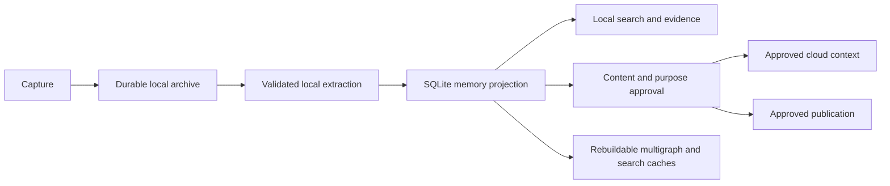

# Memory engine architecture

The maintained capability is recall of commitments, decisions, changes and their source evidence. The core runs locally. Selected professional facts can be approved for cloud synthesis; publication is a separate permission.

## Flow

`CaptureArchive` retains source revisions and tracks awaiting-source, pending, failed, dead and validated processing, with per-store projection checkpoints. Changed source content invalidates extraction; the raw file must match its stored revision hash. Quotes must be present in source text, attributed speakers and time spans must match source segments, and non-null owners, dates and completion states require evidence.

Processing order is never-attempted captures first, then the fewest attempts, then the newest source, so a handful of permanent failures cannot starve the queue. A capture that reaches `MAX_ATTEMPTS` (8) becomes `dead` and leaves the queue instead of retrying forever; `error` keeps the last reason. Extraction checkpoints are invalidated per part — a single malformed part drops only its own cache entry, and the healthy parts of the same capture stay cached. Every failed run appends the exception and traceback to `data/memory/failures.log`; the status file keeps the exception type plus a short detail string.

Transcript extraction tiles the source exactly (chunks concatenate back to the original) and extends a chunk rather than splitting a recorded utterance at the bound. Projection chunks snap to newlines or spaces for the same reason. Relative dates use the source occurrence in `JARVIS_TIMEZONE` (America/New_York by default); ambiguous dates stay null. The prompt carries an explicit `calendar_dates` map (`today`, `tomorrow`, and `upcoming`/`following` per weekday) so a small model resolves "next Monday" arithmetically instead of guessing. Kind and status are coupled in the JSON Schema itself (`Task` = open/done/cancelled, `Decision` = decided/superseded), so an invalid pair cannot be decoded at all. A chunk classified as small talk no longer downgrades the whole capture, and a mixed capture whose model omitted `professional_slice` rebuilds that slice from the professional actions' own verbatim evidence. Full recordings remain local; mixed conversations require a verbatim professional slice before professional projection.

SQLite holds canonical graph entities and relations. NetworkX and lexical caches derive from SQLite; caches do not decide deduplication or persist edits on their own. `BEGIN IMMEDIATE` serializes identity and mutation decisions across processes. A persistent connection's `data_version` detects external commits independently of the store's own writes.

## Identity and freshness

- Event, Task, Decision and Chunk occurrences preserve their stable IDs even when wording repeats. Source-backed Documents and Concepts also preserve source identity.
- Content deduplication applies only to unanchored Concept, Document, Code, Skill, Tool and Tag records with matching label, source application, domain and corpus. It runs inside the SQLite transaction.
- Same-ID updates retain the original birth time read from SQLite. Source occurrence and ingestion timestamps remain separate properties.
- Snapshots omit vectors — they are derived and rebuildable — so a restore marks affected entities `embedding_status=pending` for local re-embedding. Snapshot files are gzipped and retention keeps the newest files plus one per day for a week, so a bulk ingest cannot overwrite yesterday's restore point.

Every committed entity recomputes its name-and-description content hash. An unchanged input may retain its vector; changed input clears inherited vectors and sets `embedding_status=pending` until local re-embedding supplies a fresh vector.
- Newly generated vectors carry `embedding_content_hash` and, when known, `embedding_model`. The laptop embedding default is `embeddinggemma:latest`; explicit `OLLAMA_EMBED_MODEL` overrides are preserved. Untagged names and their `:latest` alias compare equivalently. Known incompatible models are excluded from semantic comparison. Legacy vectors without model provenance remain usable until reviewed or rebuilt; equal dimensions alone cannot prove compatibility.
- Relations use their IDs as multigraph keys. Multiple relation types can connect the same pair. Inverse creation, replacement and deletion commit atomically. Typed neighbor traversal follows outgoing relations; bidirectional relations provide explicit inverse edges.
- Public entities and query results are detached copies. Call `update_entity` or `add_entity` to persist edits. Read access does not change the content update time.

## Retrieval and client boundaries

Search blends lexical and semantic scores with importance and recency, but the two priors are gated by relevance: importance and recency may reorder real matches, never lift a single incidental token above a caller's relevance floor. Scores stay absolute and comparable across stores and calls. Stored vectors are held in a cached, normalized `float32` matrix per embedding model, so a query is one matrix product rather than a Python cosine loop over every entity.

`kg_search` and `kg_recent` default to `corpus="memory"`. Use `corpus="reference"` for news/research feeds or `corpus="all"` explicitly. The Python store defaults to all for compatibility. SwiftRecap and trend feeds infer the reference corpus when older rows lack a declaration.

`kg_recall_actions` returns Task/Decision records with quoted source evidence. It accepts owner, status, source and creation-date filters. Hits carry source URL/application/path, properties including evidence, domain, corpus and independent cloud/publication permission status. Presence of quoted evidence is not a guarantee that every manually authored claim is true; archive extraction performs quote validation.

Task/Decision lexical recall indexes owner, due date, status and evidence quotes/speakers alongside the description. This supplement is limited to 32 evidence entries and 8,192 total characters; arbitrary properties and other entity labels are excluded. Metadata changes refresh the lexical cache without changing the name/description embedding input.

A cloud-connected MCP client should run with `KG_EXPORT_ONLY=1`. In that mode, every content read requires `export_allowed(entity, purpose="cloud")`; traversal uses an approved-only subgraph and cannot bridge through private nodes, cached per store revision rather than rebuilt per call. `kg_get_stats` returns approved-only counts and labels them `read_mode: approved_exports`, so an aggregate response cannot reveal how much private material exists. Mutable access/update metadata and all fingerprint-excluded embedding/approval properties are omitted. Relation free-text reasons are omitted and arbitrary relation IDs become opaque identifiers because entity approval does not bind those fields. The connector denies writes. Aggregate graph statistics remain available. `kg_policy` explains the current mode.

A trusted local client may leave `KG_EXPORT_ONLY` unset for full local recall and editing. Do not connect that unrestricted server to a cloud inference client. Personal and professional stores remain separate.

## Inference and export

Engine Ollama HTTP helpers accept loopback HTTP endpoints only, disable environment proxies and reject redirects. Search falls back to lexical retrieval if local embedding is unavailable. Local generation is serialized by the shared laptop inference lock. Structured generation rejects incomplete/truncated responses and validates JSON Schema locally. Chat generation keeps a truncated answer and appends an explicit truncation note instead of discarding prose the model already produced. A prompt budget derived from `num_ctx` minus the answer reserve bounds every request: oldest history is dropped first, an oversized block is trimmed from its middle with a visible marker, and the system rules and live question always survive. Library diagnostics default to stderr to preserve MCP stdout framing. No graph text is automatically submitted to Anthropic: the optional linker fallback requires a matching source description and content-bound cloud approval.

Routine local generation explicitly requests `think=false`. Structured capture extraction defaults to `jarvis-extract:gemma4-12b`; chat and daily brief synthesis default to `jarvis-recall:qwen3.5-9b`. These profiles reuse the tested Q4_K_M weights. `JARVIS_EXTRACTION_MODEL` and `JARVIS_RECALL_MODEL` select their respective roles; `JARVIS_LOCAL_MODEL` overrides both. Daily synthesis may separately set `JARVIS_BRIEF_MODEL`, and linker concept extraction retains its `OLLAMA_CHAT_MODEL` override. Set `JARVIS_LOCAL_THINK=1` only for deliberate local reasoning through `local_llm`; linker concept extraction always disables thinking. Generation limits active context to 16,384 tokens and unloads after two idle minutes. `JARVIS_OLLAMA_KEEP_ALIVE` adjusts residency per host (for example `10m` on a desk-bound laptop) without changing the documented default.

Domain classification does not grant export permission. New legacy staging entities, trend-feed entities and manually indexed sources default to `export_policy="local_only"` with no permissions. Raw captures cannot be approved. Changes to approved facts or evidence invalidate approval. Derived embedding bookkeeping does not change the approved text projection.

## Compatibility and limits

The legacy staging adapter retains a 2,000-character local Event projection and supports `transcript` and `text`. It marks that projection as raw and denies export. Use the durable archive and source chunks for full transcript recall; do not treat the legacy description as a complete recording.

Manual source Markdown indexing stores its whole-file revision in `properties.source_version`, separately from embedded-content identity. Source claims use source-specific IDs. Legacy data is not automatically deleted, reclassified or re-embedded when the engine imports. Backfill and reconciliation should use archived evidence and verified backups.

SQLite identity changes are transactional per mutation. Projection of an entire conversation into multiple graph stores is not a distributed transaction; stable IDs and retryable archive states allow reconciliation after interruption. Checkpoints also verify projected entity contents and relation endpoints, repairing deleted or altered managed projections. Cleanup is limited to archive-managed IDs and exact legacy canonical parents marked as awaiting validation; manual records are retained. Source quoting and deterministic owner/date/status checks reduce fabrication but do not independently prove the model's semantic interpretation or domain classification. This work does not benchmark sustained laptop inference or prove the value of briefs; measure recall accuracy, correction effort and maintenance during the usefulness trial.
